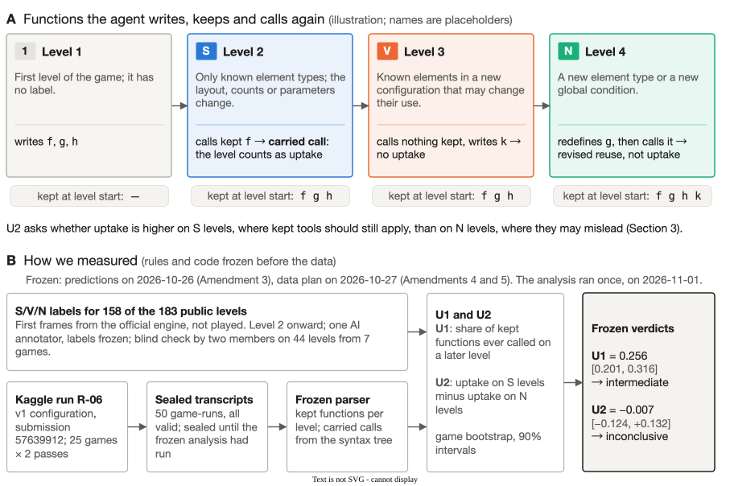
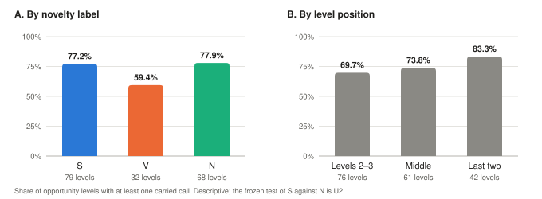
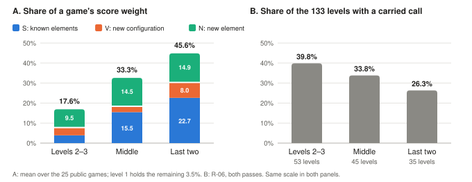
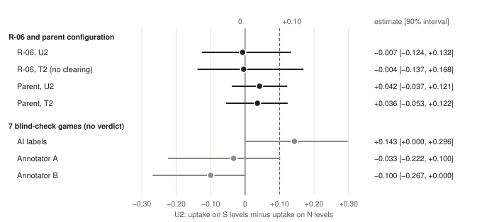
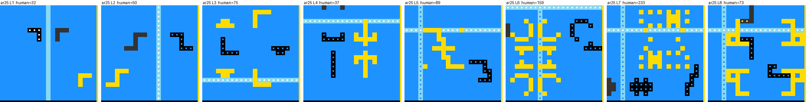

# Built Once, Used Where? Self-Written Tools Across ARC-AGI-3 Levels

Kaggle team 42

ARC Prize 2026 Paper Track, ARC-AGI-3 track. Version of 2026-11-09.

**Submission and measured configuration.** Our leaderboard submission for this paper is 57733983 (`kefeiyan/arc3-franzen-ka3-s9`, version 1), with a public score of 32.81, rank 260 of 4,926 entries on the public leaderboard as read after the competition closed. Private scores are published after this paper's deadline, so none is reported here. The reuse measurement was made on an earlier configuration of the same agent line, submission 57639912 (`kefeiyan/arc3-franzen-ka`, version 1, public score 22.55), which was fixed as the measurement target on 2026-10-27 (Amendment 4), before the data existed and before S9's first submission on 2026-10-28. Table 2 lists every difference between the two.

**Materials.** Notebooks: <https://www.kaggle.com/code/kefeiyan/arc3-franzen-ka3-s9> (S9), <https://www.kaggle.com/code/kefeiyan/arc3-franzen-ka> (v1), <https://www.kaggle.com/code/kefeiyan/arc3-paper-v1cfg> (the measurement run). Labels, parser, analysis code, frozen outputs and the pre-registration with its amendments: <https://github.com/cliff003/built-once-used-where>. Paths in this paper are relative to that repository.

## Abstract

ARC-AGI-3 scores an agent by how few actions it needs relative to humans. Code-writing agents leave Python functions behind as they play, and a widely copied open harness keeps those functions across levels. We wanted to know whether such an agent actually uses its old tools, and whether it uses them where they fit: on levels that recombine known elements rather than on levels that add new ones.

It does carry its tools forward. In the configuration of a scored Kaggle submission (25 public games × 2 passes, all 50 game-runs valid), 0.256 of the kept functions are called again on a later level (90% interval 0.201–0.316; intermediate under our frozen rule), and about three quarters of the levels where reuse was possible see such a call, more often late in a game. In the cases we sampled, the carried functions work as measuring instruments, locating markers and reading the board, rather than as solvers. Uptake was about the same on levels with only known elements (77%) as on levels with new ones (78%): in our data the agent took its tools into new levels as often as into familiar ones. The difference, −0.7 points with a 90% interval of −12.4 to +13.2, is too imprecise to say whether the agent is selective (inconclusive). The parent configuration gives the same two verdicts.

We contribute a novelty annotation of the public levels (158 labelled; two project members agreed with it at Cohen's κ 0.50 and 0.27, and with each other at 0.33), an action-economy account of where reuse should pay, and the pre-registered measurement, with labels, parser and frozen outputs that anyone can rerun without spending submissions. The split by level novelty is the new part. Whether such agents reuse their scripts was asked before (Wu et al., 2026), and the action-economy reading builds on AERA and Tycho, but as of 2026-11-05 we found no post or paper, in the ARC-AGI-3 forum or on arXiv, that splits reuse by level novelty (other Paper Track entries are not yet public). Our best leaderboard score, 32.81 (public rank 260 of 4,926 at close), came from a later version of the measured agent.

## 1. Introduction

ARC-AGI-3 measures action efficiency, which the benchmark authors treat as learning efficiency (ARC-AGI-3 technical report, arXiv 2603.24621).

Code-writing agents produce their own reusable resources while playing. In Franzen's Milestone-2 harness these are Python functions kept across levels (`ARC3_PERSISTENT_FUNCTIONS_SCOPE=game`), steered by level-transfer guidance; a public fork adds a "solved-level memory" rule per level.

**What we expected.** Wu et al. (arXiv 2610.11450) found that a coding agent on ARC-AGI-3 rarely reuses its scripts across task boundaries, and our two ft09 pilot runs, later excluded from the analysis, looked the same: many functions kept, almost no later-level use. We also expected reuse to matter most on late, high-weight levels, which often use only known element types: half of the last two levels are S and a third are N. The value of an intermediate result depends on what it enables later. So we asked two questions. Does the agent carry its own tools forward? And does it do so where reuse fits, on levels that recombine known elements, rather than where it may mislead, on levels that add new ones? Figure 1 shows what we count and how we measured it.

**Figure 1.** What we measure. A: an illustration with placeholder function names. Each level from level 2 on is labelled S, V or N (Section 4). A level counts as uptake when the agent calls a function it kept from earlier levels without first redefining it; a redefinition counts as revised reuse (Section 5). B: the measurement pipeline; the verdicts are those of Section 7.1.

**What we found.** The agent carries its tools forward more than the pilots suggested. About a quarter of its kept functions are called again on a later level, and most levels where reuse is possible see such a call, increasingly so late in a game. In the cases we sampled, the old functions serve as measuring instruments rather than as solvers. Uptake was about the same on familiar and on new levels, 77% against 78%, and the 90% interval of the difference, −12.4 to +13.2 points, is too wide to say whether the agent reuses where reuse fits better (Section 7).

**Contributions.**
- **C1.** An S/V/N annotation of the 183 public levels (158 labelled, from level 2 on). S levels carry 42% of a game's score weight and N levels 39%, and half of the last two levels are S. One AI annotator labelled them. In a blind check of 44 levels, two project members agreed with these labels at κ 0.50 and 0.27, and with each other at 0.33 (Section 4).
- **C2.** An action-economy account of the score that says where reuse should pay. Building on AERA (arXiv 2605.25931), which reads the score's quadratic as a second-order penalty, and on Tycho's active abstraction (arXiv 2607.28287), which asks when building or using a model pays, we specialise the argument to code the agent already has and turn it into a testable prediction (U2).
- **C3.** A measurement of reuse uptake in the configuration of a scored submission. U1 revisits Wu et al.'s question with a different model, harness and unit of count; U2, the split by level novelty, is the new part. The rules were frozen before the data.
- **C4.** The submitted agents, their public-leaderboard scores, and a setting-by-setting comparison with the public base notebook (Section 6).
- **C5.** The released annotation, transcript parser, analysis code and frozen outputs.

> **Terms.** A *game-run* is one game played once; a *pass* plays each public game once. A function is *kept* when the harness lists it as retained (Section 6), and *kept at the start of a level* when it is listed before the level's first snippet. A kept function is *eligible* if it was defined before the last level the run reached. A *carried call* calls a function kept at the start of the level that the level has not redefined. An *opportunity level* is a level from level 2 on that starts with a kept function; it shows *uptake* if it has a carried call. *Revised reuse* is a kept function redefined on a later level. S, V and N are level labels (Section 4); S9 is the name of a notebook configuration (Section 6), unrelated to the S label.

<!-- two boxes -->

> **For other teams.** Three points from this study that need no new runs:
>
> - **Timeouts were rare.** In the measured configuration, 27 of 4,335 Python calls timed out and 94% of eligible functions survived to a later level. Keeping functions after a timeout, as our later submissions and several public notebooks do, can change little here (Sections 6 and 7.1).
> - **One leaderboard score is a noisy draw.** Three identical submissions of our S9 configuration scored 32.81, 24.24 and 28.96, and unchanged forks of Franzen's notebook show a single-draw SD of about 3–4 points. Even with a single-draw SD of only 2.2–3.1 points, detecting a 1.5-point gain with 80% power takes 27–53 submissions per configuration (Appendix F.3).
> - **Past an overshoot of three, saving actions adds little.** A level scores $(h/a)^{2}$, with $a$ the agent's actions and $h$ the human baseline, so at an overshoot $k = a/h = 3$ one more action costs 1/27 of what it costs at parity (Section 3.1). Completing a level is worth much more than shaving actions off it.

## 2. Background and related work

**Scoring.**
- Each level scores $\min\bigl(1.15,\,(h/a)^{2}\bigr)$, where $h$ is the human baseline and $a$ the agent's actions. Level weights equal the level index.
- A game's score is capped by the weight of its completed levels, so actions on a level that is never finished cost nothing.
- A level RESET counts as an action: it returns to the start of the current level and the action count keeps growing. There is no 5×-human cap on Kaggle (Kamradt, forum posts 687187 and 713921).

**Harnesses.**
- Tufa Labs Duck (Milestone 1).
- Franzen Milestone 2, whose scheduler priority already uses level weight and actions spent, with persistent functions and level-transfer guidance.
- Public forks, which add solved-level memory and a no-op repeat guard. One write-up (public score 33.68, forum post 755700) reports that a pinned memory of solved levels did not help on its validation metric and that a no-op guard gained on public games but lost 8.0 on the leaderboard, each from few draws.
- Carry-over designs differ. A forum comparison of the Milestone 2 winners (post 744792) lists Python functions kept for the whole game (Franzen), saved per-game modules (Lord Han Solo) and pinned rules with no Python state (rellik13). Keeping functions after a sandbox timeout, which our later submissions do, also appears in ondrewsha's public S9 notebook and in a write-up with public score 43.73 (post 755837); neither isolates its effect.

**Exploration and world models on ARC-AGI-3.** These works study how an agent explores a game, models it or keeps memory; none of them splits an agent's reuse of its own code by level novelty (Novelty, below).
- Explore Before You Solve / AERA (arXiv 2605.25931) splits play into exploring, verifying and planning, and reads the score's quadratic as a second-order penalty in a trade-off between speed and depth. It also reports that all 25 public games can be cleared by non-intelligent strategies.
- OPINE-World (arXiv 2607.01531) builds a Bayesian, exploration-centred programmatic world model and orders its exploration by ontology errors.
- Tycho (arXiv 2607.28287) models a game as a parameterized Moore machine and asks when building, repairing, using or bypassing a model is worth its cost (active abstraction).
- Rodionov's *Executable World Models* (arXiv 2605.05138) checks a world model by replaying the history, refactors it toward simpler abstractions and audits information leakage. In his *Do Coding Agents Need Executable World Models…* (arXiv 2607.15439), the differences between four agent variants are smaller than the gains from a stronger model or more reasoning effort.
- PRO-LONG (arXiv 2607.20064) manages long-horizon context with programmatic memory; Wu et al.'s loop is taken from it.
- Graph-Based Exploration (arXiv 2512.24156) explores a state graph without training, an early baseline.

**Self-written code on ARC-AGI-3.**
- **Wu, Passenger & Song, *Tracing the Thoughts of a Coding Agent Playing ARC-AGI-3* (arXiv 2610.11450).** This is the closest prior work, and it answers our U1 question in its own setting.
  - Setup: 3 backbones and 7 evaluations, four with closed frontier models and three offline with Qwen3.8-27B-FP8 (RHAE 6.8–8.4%), in a loop taken from PRO-LONG whose memory lives in files.
  - Findings: scripts are referenced across task boundaries 33 times out of 630, and 72 function pairs recur across a level change by copying; 74% of pre-boundary scripts are abandoned; notes are appended rather than revised; the costliest error is carrying hard-coded values into a task where they no longer hold. Only the three Opus 5 runs reuse any script across a level change. The three Qwen runs reuse none, by reference or by copying.
  - Differences from our study: file-based memory rather than a persistent function table, no run is a scored Kaggle submission, no split by level novelty, and no frozen decision rules.
  - We see the rewriting they describe in one of our cases, where it counts as non-uptake under our frozen definition (Section 7.1).
- **Lencevicius, *When the harness decides success* (arXiv 2610.26632).** Pre-registered probes of ARC-AGI-3 harness components, and a precedent for pre-registration here.
- **Lehmann & Vahdati, *Can LLMs Improve Their Own Harness?* (arXiv 2610.30499).** Dev-set gains overstate held-out gains (+2.80, interval [−1.44, 7.35]), one reason we report pre-registered results.

**Saturation of the public games.** Kepler (arXiv 2610.00834) reaches 100.00 with Opus 5 at about $778; see also Tycho, Schema (arXiv 2609.39140) and Twin (arXiv 2608.14490). Our object is an offline, open-model Kaggle agent, and we study its behaviour on these games rather than its score.

**What moved the leaderboard.** Public write-ups attribute most leaderboard gains to serving throughput rather than agent changes. One kept Franzen's agent unchanged and rose from about 26 to 33.68 through inference-engine changes alone (forum post 755700). Another, at public rank 6 (54.55), describes about 3,500 generated tokens per second across 110 sessions (post 755758). We look at a different side of the agent: what it does with its own tools, on the serving stack of the public base notebook.

**Reusable tools and skills.**
- Library learning and tool making: Voyager (Wang et al., arXiv 2305.16291) keeps a library of code skills; LATM (Cai et al., arXiv 2305.17126), CRAFT (Yuan et al., ICLR 2024) and ReGAL (Stengel-Eskin et al., ICML 2024) make, retrieve or refactor tool functions; DreamCoder (Ellis et al., arXiv 2006.08381) and LILO (Grand et al., ICLR 2024) learn libraries of program abstractions; AWM (Wang et al., arXiv 2409.07429) stores reusable workflows; DynaSaur (Nguyen et al., COLM 2025) accumulates Python functions as actions. They build and evaluate such libraries; none is on ARC-AGI-3 or splits reuse by novelty.
- Agent Plasticity (Singh et al., arXiv 2610.08902): agents often fail to reuse relevant artifacts. It is not on ARC-AGI-3 and has no novelty split.
- Hajimiri et al., arXiv 2606.15017: at a fixed budget, a plain actor matches or beats skill and memory modules.
- TroVE (Wang et al., arXiv 2401.12869) induces verifiable, efficient toolboxes of functions for programmatic tasks, a classic case of a model building its own tools. It is not on ARC-AGI-3 and has no novelty split.
- Suppa & Kopčan (COLM 2026): on two benchmarks outside ARC, creating tools and then discarding them matches creating and keeping them.
- Two ICLR 2027 submissions, under review, ask when an online agent should build, patch or reuse a tool (*When Should Agents Build Reusable Tools?*) and define skill debt (*Measuring and Repaying Skill Debt in Lifelong Language Agents*).

**Novelty.**
- Wu et al. showed that code-writing agents on ARC-AGI-3 rarely carry their scripts across task boundaries. U1 asks the same question within a game, counting calls to kept functions on later levels; the units differ, so the two figures are not directly comparable.
- We add two things:
  1. uptake split by annotated level novelty (U2). We found no post or paper that does this, in the ARC-AGI-3 forum and on arXiv as of 2026-11-05 (other Paper Track entries are not yet public). Library-learning agents (above) evaluate the libraries they build, not where an agent calls its own functions as levels change.
  2. a measurement on the configuration of a scored Kaggle submission, with the model and harness of Franzen's public notebook, which many teams copied or built on. The leaderboard does not record a team's harness; public write-ups with public scores of 54.55, 43.73 and 33.68 state that they build on it.
- Nearest neighbours. *Compiled Worlds* (ICLR 2027 submission, under review) edits official ARC-AGI-3 games into variants and compares adaptation costs by variant type; its variants are hand-made, mostly on first levels, and it counts calls and completion, not self-written functions. Liu et al. (arXiv 2610.34523) annotate mechanism triggers and recognition on the 25 public games for humans and LLM agents; they do not measure tool reuse.
- Keeping helpers across levels and telling the model to re-check carried knowledge both come from Franzen's harness; we build on these features and measure how the agent uses them.

## 3. Theory: the action economy and the value of reuse

**3.1 Score structure** (numbers from the 25 public games).
- The marginal cost of one more action at overshoot $k = a/h$ is $$\lambda_\ell(k) = \frac{2\,w_\ell}{k^{3}\,h_\ell}$$ in game-score units.
- At human parity, a level-1 action is only about 1.5× cheaper than a last-level action (median; range 0.32–14 across games), because level-1 baselines are small. At $k = 3$, an action costs 1/27 of what it costs at parity.
- Level 1 carries 3.5% of a game's score on average, S levels 42.0% and N levels 38.9%. The last two levels are 50% S.

**3.2 Value of reuse.**
- **Cost and benefit.** Reusing a resource on level $\ell$ saves $\Delta a$ actions when it still applies. It costs a check $c$, and when it no longer applies it misleads with probability $p$, wasting $m$ actions.
- **Net value.** In score units the net value is about $$\lambda_\ell(k)\,\bigl(\mathbb{E}[\Delta a] - c - p\,m\bigr),$$ plus the larger effect of turning a failed level into a completed one, worth $w_\ell\,s_\ell$.
- **Implication.** Reuse has the most to gain on late S levels, which hold the largest share of a game's weight, and the most to lose on N levels. A selective agent would show higher uptake on S than on N.
- **What the prediction rests on.** $\lambda_\ell(k)$ is the same whether or not the agent reuses on a given level, so it sets how much a level matters, not whether reuse pays there. S > N comes from two assumptions: on S levels a kept tool is more likely to still apply (larger $\mathbb{E}[\Delta a]$) and less likely to mislead (smaller $p$) than on N levels. The agent never sees the labels, so to be selective it has to recognise from the board how much a level has changed.
- **Relation to Tycho.** This specialises Tycho's active abstraction to code the agent already has; what we add is the testable prediction U2.

**3.3 Predictions** (frozen in Amendment 3, 2026-10-26T04:52:42Z). Statistics use a game bootstrap with 90% intervals. We fixed the thresholds with the question, before any data, as round conventions: a quarter and a half of the eligible functions, and a 10-point difference in uptake.
- **U1, reuse share**: the share of kept functions that are ever called on a later level.
  - *Rarely reused*: upper bound < 0.25.
  - *Commonly reused*: lower bound > 0.50.
  - Otherwise: *intermediate*.
- **U2, selectivity**: uptake on S opportunity levels minus uptake on N opportunity levels.
  - *Selective*: lower bound > 0.
  - *Reverse*: upper bound < 0.
  - *No meaningful selectivity*: upper bound < 0.10.
  - Otherwise: *inconclusive*.
- **Data floors**: at least 8 games; for U2, also at least 15 opportunity levels in each of S and N.

## 4. Level annotation

- **Labels.** All 183 public levels of the 25 games were rendered from their first frame with the official engine, without playing. Every level from level 2 on (158 levels) carries one label. The definitions were written in Chinese, and the human annotators saw them in Chinese (Appendix A); in English they read:
  - S: no element type that earlier levels lacked; only the layout, counts, sizes or parameters change (colours, key shapes and the like);
  - V: known elements in a new configuration that may change how they are used, for example a mirror axis turning from vertical to horizontal, two chains crossing or a palette gaining colours;
  - N: a new element type or a new global condition, such as a new object, a new interface element or fog.
- **Split.** N 44%, S 40%, V 16%. The last two levels are 50% S.
- **Annotator.** A single AI annotator (a Claude session) labelled all levels. The primary analysis keeps these frozen labels, as pre-registered.
- **Human check.** Two project members, A and B, each labelled 44 levels from 7 games (seed 20261026) from first frames only, with the definitions above, blind to the AI labels and to each other (Appendix A, Table A2).
  - Against the AI labels, Cohen's κ was 0.50 [0.31, 0.68] for A and 0.27 [0.12, 0.42] for B (raw agreement 68% and 55%; 90% game-bootstrap intervals).
  - Between A and B, κ was 0.33 [0.19, 0.46] (raw 59%). This comparison is a descriptive addition to the registered check.
  - Most disagreements involved V (36 of 52 over the three pairs). Both humans used N less often than the AI: 14 and 12 of the 44 levels, against 24.
  - On these 7 games U2 is +0.143 with the AI labels, −0.033 with A's and −0.100 with B's (Figure 4). Seven games are below the 8-game floor, so these are estimates without a verdict.
- **Human baselines.** They show no association with the labels after controlling for game and position, so they cannot validate the labels.

## 5. Measurement design

**Data (Amendments 4 and 5, frozen 2026-10-27).**
- **Primary (R-06).** A Kaggle Save & Run of the measured configuration on the 25 public games, 2 passes, after the 2026-10-31 quota reset; about 4.5 GPU-hours were approved in advance.
  - The measured agent is pinned to `arc3-franzen-ka` version 1 (submission 57639912). Only the run mode differs: all 25 games, 2 passes, and a per-game wall clock scaled to the competition share.
  - The transcripts and request logs were sealed (gzip and a SHA-256 manifest) until the frozen analysis had run once, on 2026-11-01.
  - The run (`kefeiyan/arc3-paper-v1cfg`, version 1) took 4.15 GPU-hours on one RTX PRO 6000. A safety stop at 290 minutes, registered before the run, did not trigger.
- **Excluded.** Every run another agent session had already read is listed in Amendment 4 §2 and excluded as a whole run.
- **Parent-configuration replication.** Franzen's own public Kaggle runs of Milestone 2 version 3 (25 games × 4 passes), analysed once with the same frozen code. The results are in Section 7.2.

**Parsing (frozen).**
- *Snippet*: a `[TOOL CALL: python]` block.
- *Level of a snippet*: the latest `Current state: … level L.` line before it.
- *Kept at the start of a level*: the first "Your retained functions…" line of that level, before its first snippet.
- *Carried call*: an AST call to a function kept at the start of the level and not yet redefined at that level.

**Measures.**
- Primary: U1 and U2.
- Descriptive: opportunity rate, uptake on V levels and by position, revised reuse, and approximate actions on S levels with and without uptake (confounded).

**Clearing of kept functions.**
- With game scope, any of the following empties the whole kept table: a sandbox timeout (30 s), a start failure, a crash, or an invalid response. The model is then told each function "is no longer retained".
- This lowers U1 mechanically and can shift U2. It is part of the measured agent, so the primary analysis keeps it.
- Two pre-registered sensitivity analyses address it: T1 (U1 over functions that survive to a later level) and T2 (U2 on levels without involuntary loss).

**History of the question.** The pre-registration as first frozen (2026-10-25) asked a causal question: does keeping the agent's functions across levels, against clearing them at each new level, save actions on S levels without costing actions on N levels (P1/P2)? Amendment 3 (2026-10-26) replaced it with the present observational question after two ft09 pilot runs of the measured model, now excluded, showed almost no calls to kept functions on later levels; no confirmatory data existed then, and the ablation became optional. Its manipulation-check gate had to be passed by 2026-10-30, and no candidate model passed by then (Appendix F.1), so the ablation never ran and we make no P1/P2 claim. R-06 ran after that deadline, and on the four registered gate games the measured model meets all three gate conditions (199 kept functions, 17 with a carried call on a later level, 34 completed levels). The ablation is therefore feasible with this model, and it is the natural next step.

## 6. The submitted agent

**Base.** All our ARC-AGI-3 submissions start from Franzen's public Milestone 2 notebook: Tufa Labs' Duck harness with Franzen's patch, and Qwen3.8-Flash-Next in Intel's W4A16 AutoRound quantization, served by Pennyroyal SGLang with speculative decoding from an MTP draft model. A run takes one RTX PRO 6000 and a 9-hour Kaggle session without internet access, and plays 110 hidden games.

**How the agent plays.**
- Each game is one long conversation with the model. The context window is 128k tokens, and older turns are drained when it fills.
- The model sees the board as an upscaled image with frame diffs, thinks, and calls a Python tool with a 30 s timeout that can inspect the board and take actions. UNDO is available; RESET is not, except as noted for S9 in Table 2.
- Functions it defines stay available for the rest of the game (`ARC3_PERSISTENT_FUNCTIONS=1`, scope `game`), and level-transfer guidance tells it to re-check what it carries to a new level (`ARC3_LEVEL_TRANSFER_GUIDANCE=1`). Each turn's prompt lists the kept functions by signature only, for example (R-06, ar25, second pass): "Your retained functions from earlier Python calls in this game: pieces(f), hud(f). These are your previous definitions, available to call directly. Their presence does not mean they are correct; revise them if new evidence contradicts their assumptions." Their bodies remain only in earlier turns of the conversation. The guidance adds to the system prompt: "Carry forward supported knowledge as a starting hypothesis, while re-checking anything contradicted by new evidence."
- A scheduler keeps up to 10 games streaming at once and orders the rest by a priority that uses level weight and actions spent.

**Notebooks, runtime and licences.** Table 2 compares the notebooks. All of them use the same pinned Kaggle Docker image and the same inputs: the datasets `dfranzen/pennyroyal-v253` (serving wheelhouse) and `dfranzen/taaf-kaggle-source-bundle-copy` (harness source), and the Kaggle Models `dfranzen/intel-qwen3.8-flash-next-w4a16-autoround` and `dfranzen/albucino-qwen3-8-flash-next-drafter`. The weights are referenced, not redistributed. The Flash-Next weights carry the Qwen Community License (`qwen-community-1.0`); see Section 10.

**Submissions.**
- **First submission.** Submission 57639912 came from `kefeiyan/arc3-franzen-ka` version 1 (Franzen Milestone 2, a startup keep-alive, solved-level memory always on). Its public score was 22.55.
- **Later submissions.** Table 1 lists every scored submission. From 57677016 on (`kefeiyan/arc3-franzen-ka3` and its S9 variant), the agent keeps its functions when a snippet times out (`ARC3_KEEP_FUNCS_ON_TIMEOUT=1`), so the clearing mechanism of Section 5 does not apply to these submissions. T1 and T2 come closest to that case, but the later agents differ in other ways too (Table 2). The best public score is 32.81 (57733983). For the final ranking we selected 57677016 and 57733983 on ARC-AGI-3 and 57747922 and 57855800 on ARC-AGI-2, by rules written before the last scores arrived; they are also the two highest public scores on each track.
- **Position.** On the public leaderboard read on 2026-11-05, after the competition closed, our team stood at rank 260 of 4,926 on ARC-AGI-3 (32.81) and rank 783 of 3,544 on ARC-AGI-2 (31.39). These are public positions, not final results.
- **Private scores.** These are published on 2026-12-04, after this paper's deadline. Our main result comes from the 25 public games (Section 7.1).
- **Validity rule.** All three of the last scores (57854805, 57855800, 57889673) passed a rule for discarding failed runs that we fixed on October 28, although for 57889673 the status polling that the rule required lapsed before the score appeared (Appendix F.2).
- **Credits.** The notebooks' credit cells name Tufa Labs (Duck harness, TAAF), Daniel Franzen (Milestone 2 solution, serving build), rellik13 / sirikilohit and lalalia9 (solved-level memory), John Pezzulli (Pennyroyal SGLang), Qwen, Intel (AutoRound) and Albucino (MTP drafter). S9 also credits ondrewsha's public S9 notebook.

**Table 1.** Leaderboard submissions of our team, from the Kaggle submission list as read on 2026-11-02 and again after the deadline, on 2026-11-03. † marks the two submissions selected for the final ranking on each track. Identical configurations were submitted more than once to see the draw-to-draw spread. Private scores are published on 2026-12-04, so the table lists public scores.

| Track | Submission | Date | Configuration | Public score |
|---|---|---|---|---:|
| ARC-AGI-3 | 57639912 | Oct 25 | v1: Franzen M2 + startup keep-alive + solved-level memory (measured in R-06) | 22.55 |
| ARC-AGI-3 | 57677016† | Oct 26 | ka3: v1 + absolute end time (542 min) + keep functions on timeout + size guard | 29.11 |
| ARC-AGI-3 | 57698455 | Oct 27 | ka3, second draw (identical) | 28.94 |
| ARC-AGI-3 | 57733983† | Oct 28 | S9: ka3 + two public-fork rules (RESETC, HF) | 32.81 |
| ARC-AGI-3 | 57768059 | Oct 29 | S9-FT: S9 + a LoRA adapter | 28.23 |
| ARC-AGI-3 | 57790668 | Oct 30 | S9-TCAP: S9 + a thinking cap | 16.81 |
| ARC-AGI-3 | 57821827 | Oct 31 | S9, second draw (identical) | 24.24 |
| ARC-AGI-3 | 57854805 | Nov 1 | S9, third draw (identical) | 28.96 |
| ARC-AGI-3 | 57889673 | Nov 2 | S9-FT guard: S9-FT + gateway-call retry, base-model fallback, 1800 s gateway wait | 27.80 |
| ARC-AGI-2 | 57640024 | Oct 25 | v1: public NVARC copy, unmodified | 28.89 |
| ARC-AGI-2 | 57677013 | Oct 26 | v2: NVARC + attempt-2 hedge + checkpoint and validator | 30.14 |
| ARC-AGI-2 | 57712737 | Oct 27 | v2, second draw (identical) | 27.78 |
| ARC-AGI-2 | 57747922† | Oct 28 | v3a: v2 + cost order + hard stop | 31.39 |
| ARC-AGI-2 | 57782794 | Oct 29 | F1-FN variant, without MTP decoding | 30.28 |
| ARC-AGI-2 | 57818447 | Oct 30 | F1-FN variant, MTP decoding first | 29.44 |
| ARC-AGI-2 | 57855800† | Nov 1 | V23: verbatim copy of a public two-pass NVARC notebook | 31.39 |

**Table 2.** How the ARC-AGI-3 notebooks differ from Franzen's Milestone 2 notebook, setting by setting. Everything else is the same in all four: we compared the cell sources, and the environment block, the server launch cell and the harness patch match Franzen's. Differences that apply only to commit runs are left out. The later notebooks store the patch compressed; its content is unchanged. The R-06 notebook equals v1 apart from the run mode described in Section 5.

| Setting | Franzen M2 (parent, Section 7.2) | v1, 57639912 (measured) | ka3, 57677016 | S9, 57733983 |
|---|---|---|---|---|
| Startup keep-alive: games wait for the server's health check while one game sends a RESET every 8 minutes, so the gateway keeps the scorecard open | no | yes | yes | yes |
| Solved-level memory pinned in the system prompt (lalalia9's version of rellik13's M85) | no | yes | yes | yes |
| Keep retained functions when a snippet times out or its sandbox dies (`ARC3_KEEP_FUNCS_ON_TIMEOUT=1`) | no | no | yes | yes |
| Per-game clock shortened by any startup delay; run cancelled 542 minutes after notebook start | no | no | yes | yes |
| Input fallbacks: search `/kaggle/input` for a missing input; embedded copy of the TAAF bundle | no | no | yes | yes |
| Timing marks in the log (no effect on play) | no | no | yes | yes |
| Eight source edits from ondrewsha's S9: animated actions reported as ANIMATED (3 edits), `import time` allowed, a timeout reports the actions already executed, the whole-run clock hidden from the model, a note that HUD indicators may encode game state, RESET text prefers UNDO | no | no | no | yes |
| RESET offered to the model, only in games without UNDO (`EXPOSE_RESET=on`, `ARC3_RESET_WITH_UNDO=off`) | no | no | no | yes |

**Why v1, and what carries over to S9.** Amendment 3 (2026-10-26) asked about "the submitted configuration", and Amendment 4 (2026-10-27) fixed that to v1, the configuration of our first scored submission (57639912) and of the two pilot runs behind Amendment 3. It also states that a later submission that changes agent behaviour, such as a timeout fix that keeps the table, is reported as a different configuration and never pooled; ka3, submitted on 2026-10-26, is such a change. Row by row of Table 2:
- *Startup keep-alive and solved-level memory*: the same in v1 and S9.
- *Keeping functions after a timeout* (ka3 and S9): in v1 only 27 of 4,335 calls timed out, and T1 and T2, which come closest to a table that is never cleared, give the same verdicts as U1 and U2 (Section 7.1), so this difference is unlikely to change the verdicts.
- *Shortened per-game clock, run cancellation and input fallbacks* (ka3 and S9): these change timing and inputs, not the prompts or the tools, but they can change how far a game gets.
- *The eight source edits and the RESET rule* (S9 only): these change what the model is told, for example how animated actions and timeouts are reported, and, in games without UNDO, which actions it has. Their effect on reuse is not measured.

So the mechanics and the timeout result carry over to ka3; for S9, our reuse figures are a reference point, not a measurement.

## 7. Results

**7.1 Primary measurement (R-06; analysed once on 2026-11-01)**

All 50 of the 50 game-runs (25 games × 2 passes) are valid; none is invalid, cut or missing. Each game-run had a wall-clock budget of 14,509 s, and 18 of the 50 game-runs won their game. A separate agent session, which had not run the analysis, reran it from the sealed files and obtained byte-identical outputs.

| Measure | Estimate | 90% interval | Verdict |
|---|---:|---|---|
| U1, reuse share | 0.256 | [0.201, 0.316] | intermediate |
| T1, U1 over surviving functions | 0.267 | [0.211, 0.329] | intermediate |
| U2, S minus N uptake | −0.007 | [−0.124, +0.132] | inconclusive |
| T2, U2 without involuntary loss | −0.004 | [−0.137, +0.168] | inconclusive |

- **Data floors.** U1 has 25 games with eligible functions; U2 has 25 games with 79 S and 68 N opportunity levels. All floors are met.
- **Verdicts.** U1's upper bound is above 0.25 and its lower bound below 0.50, so the share is intermediate. U2's interval contains both 0 and +0.10, so, as the frozen wording requires, we state the rates and the interval and make no selectivity claim. T1 and T2 give the same verdicts. Section 10 gives the precision this design had.
- **Reuse funnel.** 4,335 Python snippets (12 with syntax errors) defined 1,956 functions. Of these, 1,355 were kept at some point, that is, listed in the harness's retained-functions line; 885 were eligible because a later level was reached after their definition; 831 of those were still kept at the start of a later level; and 190 were reused. The other 601 defined functions (31%) never appeared in that line. U1 is the mean of the per-game shares, so it differs from the pooled share 190/885 = 0.215.
- **Uptake on opportunity levels.** The 50 game-runs reached 193 levels from level 2 on, and 179 of them (93%) started with at least one kept function. Uptake was 0.772 on S levels (79), 0.779 on N (68) and 0.594 on V (32). By position it rose from 0.697 on levels 2–3 (76) to 0.738 in the middle (61) and 0.833 on the last two levels (42). A kept function was redefined on 9.5% of opportunity levels (revised reuse). These rates and Figures 2–3 are descriptive; the frozen test of S against N is U2.
- **Actions on S levels.** On completed S levels, levels with uptake took more actions than levels without: the approximate action count (the step difference between the start of the level and the start of the next) had a median of 28.5 on levels with uptake (40 levels) and 19 on levels without (15 levels). This registered comparison is confounded, since harder or longer levels may simply call for more tools, so it does not tell whether reuse saves or costs actions.
- **Clearing was rare.** 27 of the 4,335 calls timed out, and each timeout emptied the kept table; 94% of eligible functions survived to a later level. The request logs record exactly these 27 infrastructure errors, game-run by game-run (50 of 50 agree), each followed by the "no longer retained" notice. No silent clearing was found. By label, clearings per 100 calls were 1.27 on S, 0.42 on V, 0.49 on N and 0 on first levels; these frequencies are not blind, and the other registered clearing descriptives are in Appendix B.
- **Cost.** The agent generated 8,493,184 tokens (median 157,677 per game-run), 576 tokens per second over the session. The mean score on the 25 public games was 47.75; the leaderboard score comes from the hidden games (Section 6).

**Table 3.** Reuse funnel per game, summed over the two passes. Kept counts functions ever listed in the retained-functions line. Share = reused / eligible; U1 is the mean of this column.

| Game | Defined | Kept | Eligible | Reused | Share |
|---|---:|---:|---:|---:|---:|
| ar25 | 123 | 89 | 85 | 17 | 0.200 |
| bp35 | 20 | 12 | 7 | 5 | 0.714 |
| cd82 | 34 | 25 | 23 | 12 | 0.522 |
| cn04 | 165 | 128 | 82 | 9 | 0.110 |
| dc22 | 34 | 30 | 16 | 9 | 0.562 |
| ft09 | 19 | 11 | 7 | 3 | 0.429 |
| g50t | 56 | 43 | 31 | 8 | 0.258 |
| ka59 | 103 | 79 | 68 | 2 | 0.029 |
| lf52 | 110 | 94 | 53 | 17 | 0.321 |
| lp85 | 115 | 45 | 38 | 9 | 0.237 |
| ls20 | 77 | 54 | 21 | 5 | 0.238 |
| m0r0 | 82 | 45 | 24 | 5 | 0.208 |
| r11l | 94 | 49 | 35 | 18 | 0.514 |
| re86 | 59 | 42 | 31 | 8 | 0.258 |
| s5i5 | 48 | 38 | 27 | 0 | 0.000 |
| sb26 | 14 | 12 | 12 | 2 | 0.167 |
| sc25 | 24 | 21 | 16 | 6 | 0.375 |
| sk48 | 43 | 30 | 17 | 3 | 0.176 |
| sp80 | 118 | 84 | 24 | 3 | 0.125 |
| su15 | 91 | 76 | 23 | 4 | 0.174 |
| tn36 | 11 | 10 | 2 | 0 | 0.000 |
| tr87 | 184 | 137 | 113 | 23 | 0.204 |
| tu93 | 226 | 111 | 60 | 8 | 0.133 |
| vc33 | 62 | 50 | 43 | 6 | 0.140 |
| wa30 | 44 | 40 | 27 | 8 | 0.296 |
| **All** | 1,956 | 1,355 | 885 | 190 | 0.256 (mean) |

**Figure 2.** Uptake on opportunity levels in R-06, by novelty label (A) and by level position (B). An opportunity level is a level from level 2 on that starts with at least one kept function; it counts as uptake when the agent calls a carried function on it. Counts are opportunity levels over both passes. Position bins: levels 2–3, the last two levels of the game, and the middle; a level that is both counts as levels 2–3.

**Figure 3.** Where the score weight lies (A) and where carried calls happened in R-06 (B), by level position. A: mean share of a game's score weight over the 25 public games, split by label; level 1 holds the remaining 3.5%. B: share of the 133 opportunity levels with a carried call. The last two levels hold the most weight and have the highest uptake rate (Figure 2B), but fewer game-runs reach them, so carried calls were most frequent on levels 2–3.

**Cases.** Three levels show what these counts look like in play. We drew them by a fixed rule before reading them: the 50 game-runs were shuffled with seed 20261101, and for each type we took the first game-run in that order with a qualifying level, and its lowest qualifying level (`drafts/cases/select_cases.py`, which imports the frozen parser unchanged). The action counts are the frozen approximation, the step difference between the start of the level and the start of the next.
- **An S level with a carried call (ar25, second pass, level 6).** The level has both mirror axes and only known pieces. The agent started it with 24 kept functions. Its first snippet printed the board segmentation and called `whites(f)`, written on level 5 to locate single-pixel white markers; later snippets called it again after each SPACE press to see which band or piece was charged. It also wrote new helpers, such as `bpos` for piece positions. The level took 17 snippets and about 64 actions. The carried function served as a measuring instrument, not as a solver.
- **An S level without one (ar25, second pass, level 2).** Same piece types as level 1 and a vertical dotted axis. Three functions were kept from level 1: `pieces`, `hud` and `state`. The agent called none of them. It wrote `scan(f, color, r0, r1, c0, c1)` and `st(f)`, which reads the same three colours as the kept `state`, but within fixed board regions instead of by node size, and it finished the level in 9 snippets and about 13 actions. Under our definition this is non-uptake, although the new helper redoes the old one's job: the rewriting that Wu et al. describe.
- **An N level where a kept function was rewritten (m0r0, first pass, level 5).** Coloured bars appear for the first time. Of 17 kept functions, the agent called one, `bars(f)`, written on level 1 to count white cells in the top and bottom rows. It redefined another. The kept `nxt(p, d, mir)` moved one piece one cell, with an optional mirror. The new `nxt` moves a pair of pieces at once and lets a piece enter a cell only if it is free, a plate, or a gate whose colour is currently open; a later version returns every legal move. The level was completed in about 51 actions. The old movement model no longer held and the agent replaced it. We count the replacement as revised reuse; the level counts as uptake only because of `bars`.

**7.2 Parent-configuration replication (pre-registered; analysed once on 2026-10-27, with a second agent session checking the run)**

Because the primary data exist, this analysis is the pre-registered replication. The data are Franzen Milestone 2 version 3, 25 games × 4 passes. Twenty-four games have data; sk48 never passed level 1.

| Measure | Estimate | 90% interval | Verdict |
|---|---:|---|---|
| U1, reuse share | 0.267 | [0.229, 0.304] | intermediate |
| T1, U1 over surviving functions | 0.289 | [0.250, 0.326] | intermediate |
| U2, S minus N uptake | +0.042 | [−0.037, +0.121] | inconclusive |
| T2, U2 without involuntary loss | +0.036 | [−0.053, +0.122] | inconclusive |

The request-log rules and the transcript rules agree on all 100 game-runs, and no silent clearing was found. In the parent configuration, about a quarter of kept functions are ever reused on a later level. The data neither show nor exclude a preference for S levels. Both verdicts match R-06 (Section 7.1). The two runs share the 25 games, the labels and the parser, so they are not independent samples, and the configurations differ (Section 6); what repeats is the pair of verdicts. The registered S-level action counts point the same way as in R-06: a median of 29 approximate actions on completed S levels with uptake (85 levels) and 19 without (21 levels). Figure 4 puts both runs next to the 7-game estimates of the blind check.

**Figure 4.** U2 (S minus N uptake) with 90% game-bootstrap intervals, all as reported in Sections 7.1–7.2 and Table A2. Top: the measured configuration (R-06, 25 games) and the parent configuration (24 games), each with its clearing-free sensitivity analysis T2. Bottom: the 7 games of the blind check, with the AI labels and with each annotator's labels; 7 games are below the 8-game floor, so these carry no verdict. The "no meaningful selectivity" verdict needs the upper end below the dashed line at +0.10.

**7.3 Exploratory (post hoc): a second view of the task on ARC-AGI-2**

One of our ideas is to give one frozen model two independent paths, one over rendered grid images and one over numeric matrices, with every candidate checked on the demonstrations; Land (2026) reports a system of this kind. We asked whether, at equal compute, a run that shows every grid as an image covers tasks that a second text run would not (Qwen3.8-27B-FP8, the same harness, 64k tokens per task, the 120 public evaluation tasks). The two rounds were each specified before their runs but are not part of the pre-registered study, and these tasks had already informed earlier project decisions, so both results are in-sample and exploratory; any bias from reusing the tasks favours the text runs. R-08 united a text run, T1, with an image run, V, or with a second text run, T2; R-09 averaged over all pairs of three text and two image runs. These run names follow the registrations and are unrelated to the sensitivity analyses T1 and T2 (Section 5) and to the V levels (Section 4). A union credits a test input that any of the pair's four attempts solves, so it bounds from above what a second view adds. On these 120 tasks we see no sign that the image view adds coverage beyond re-sampling the text view, and no sign that it does worse; a small effect is not excluded, and text runs that differ only in the seed span 12.5 points. The image runs are image-presented, not vision-only: the model can still print the arrays in its tool. Appendix D has the details.

| Round (union scores) | Text–image | Text–text | Difference | 95% CI | Verdict |
|---|---:|---:|---:|---|---|
| R-08: T1+V against T1+T2 | 43.5 | 46.8 | −3.3 | [−11.8, +5.0] | NO |
| R-09: means over all pairs | 44.4 | 44.0 | +0.4 | [−4.3, +5.6] | UNDETERMINED |

## 8. Beyond ARC

Any agent whose work leaves tools behind meets the same choice on each new task: keep a tool, check it, or rebuild it. This holds for coding agents that carry scripts between tasks, agents with skill or tool libraries (Agent Plasticity, TroVE, Suppa & Kopčan and the ICLR 2027 submissions in Section 2), and data pipelines whose transforms meet new inputs. The annotation-plus-transcript protocol carries over wherever tasks can be labelled by what they add to earlier ones and tool definitions and calls can be parsed from logs. The account of Section 3 needs four conditions: cost counted in actions or steps; structure shared across tasks, so an old tool can still apply; a check, with its own cost, before reuse; and old tools that can mislead when a task changes. It then predicts that a selective agent reuses more on tasks that only recombine known parts than on tasks that add new ones, and that keeping tools saves the most on the former and risks the most on the latter; a keep-vs-clear ablation like the one registered here (Section 5) tests the second. On ARC-AGI-3 the first was inconclusive (Section 7.1), and the second awaits the ablation.

## 9. What others can reuse

- The S/V/N labels and the transcript parser let anyone with a Duck-based harness measure reuse on the public games, split by novelty, without spending leaderboard submissions.
- The measured agent already calls a carried function on most levels where it can, and more often late in a game (Section 7.1). For this harness the open question is where the agent reuses, not whether; the registered keep-vs-clear ablation (Section 5) is the direct way to learn whether its reuse saves actions.
- Timeouts cleared little: 27 of 4,335 calls timed out and 94% of eligible functions survived to a later level. Several teams keep functions after a timeout (Section 2); in this configuration that change has little to act on.
- Public write-ups point to serving throughput as the larger lever for the leaderboard (Section 2); our protocol measures a different, behavioural side of the agent.

## 10. Limitations

- **Labels.** One AI annotator labelled the levels from first frames. In the blind check, agreement was moderate at best: κ 0.50 and 0.27 against the AI labels, 0.33 between the two humans, both of them project members. On its 7 games, U2 changes sign with the annotator, so U2 describes these labels rather than a settled measure of novelty.
- **Precision.** Post hoc, reading the width of U2's interval as a normal standard error (about 0.078), the design could detect selectivity with 80% probability only if the true S−N difference were about 19 points or more; with no true difference, the frozen rules would have returned "no meaningful selectivity" about 31% of the time and "inconclusive" about 59% of the time. For the parent configuration, the narrower interval (a normal standard error of about 0.048) gives 80% power for a true S−N difference of about 12 points.
- **What uptake counts.** Uptake is binary and close to its ceiling (77–78% on S and N levels). It counts a call to a perception helper as readily as a call to a solver, cannot tell a call that checks a tool from one that relies on it, and counts a function rewritten under a new name as not taken up (revised reuse is reported separately). The model sees only signatures of its kept functions (Section 6). Label noise attenuates any S−N difference, and U2 is not adjusted for position, while N levels carry most of the weight of levels 2–3 and S levels most of the last two (Figure 3A). These push U2 toward zero.
- **Observational.** The measurement shows where the agent carries its tools, not that carrying them saves actions; the registered keep-vs-clear ablation would test that (Section 5). Low uptake can be partly mechanical: a sandbox timeout empties the kept table (T1 and T2 address this).
- **Scope.** We measured v1, not S9 (Section 6), with one model, one Kaggle session and two passes; the per-game wall clock matches the competition's share, not necessarily its compute. The public games are easier than the hidden set, as the ARC-AGI-3 technical report states, and frontier API systems solve them. The parser depends on the transcript format of the harness version.
- **Leaderboard.** A single leaderboard score is a noisy draw, so Table 1 reports outcomes rather than evidence that any change helped (Appendix F.3). Ranks are public-leaderboard positions read after the close, before any private score (Appendix F.4).
- **Decode readings (Appendix E).** These are offline estimates from one run each, with no intervals, and were not validated on Kaggle. The headroom itself was not computed.
- **Licence.** Eligibility under the Qwen Community License is unresolved.

## 11. Conclusion

An open-model coding agent in the configuration of a scored ARC-AGI-3 submission carries its own tools forward. It keeps most of the functions it writes, calls about a quarter of them again on a later level (intermediate under our frozen rule), and makes such a call on most levels where it can, more often late in a game. In the cases we sampled, the old functions work as measuring instruments rather than as solvers. Uptake was about the same on levels that only recombine known elements and on levels that add new ones; the difference, −0.7 points with a 90% interval of −12.4 to +13.2, cannot tell whether the agent is selective. The parent configuration gives the same verdicts. The labels, parser and frozen outputs let others run the same measurement on their own agents, and the registered keep-vs-clear ablation is the natural next step to learn whether carrying tools saves actions.

## Authorship and AI assistance

The authors directed the project and made the decisions on submissions and compute. AI coding agents (Claude Code and Codex sessions) wrote most of the code, ran the experiments and drafted this text; separate agent sessions that did not write the work under review did the reviews, reruns and run checks. The two human annotators of the label check (Section 4) are project members.

## Appendix

**A. Annotation method**

- **Rendering.** Each of the 25 games was loaded with the official engine from the competition data (arcengine 0.9.3), the way the official toolkit loads it. For level i the script jumps there with `set_level(i)`, issues a level RESET and keeps the last returned frame as the level's first frame. No level was played, and all 183 levels rendered (`level_annotation/render_levels.py`).
- **Labelling.** One AI annotator labelled every level from level 2 on against the earlier levels of the same game, with the definitions of Section 4 and a one-line note per level (`level_annotation/levels.csv`). Automatically extracted features, new colours and new small-object shapes, served as aids. Level 1 has no label.
- **Human check.** The rules were registered in our internal run log, which is not published, before any human label existed (2026-11-05 15:25Z), and both label files were hashed and pushed to the private repository before any comparison (2026-11-07 16:26Z).
  - **Sample.** The 44 levels of PREREGISTRATION §7b: every level from level 2 on in 7 games drawn whole with seed 20261026 (lf52, bp35, ls20, sc25, g50t, m0r0, sp80).
  - **Procedure.** Two project members, A and B, each labelled the sample in an offline page in Chinese that shows only first frames and the Section 4 definitions and contains no AI label (`level_annotation/human_check/blind_label.html`; `blind_label.en.html` is the same page in English). Both were asked not to look at AI labels, drafts or each other's file before both had finished. Both reported no exposure to AI labels, label statistics or drafts. A's file reached the computer B labelled on about 11 hours before B started. The page's self-report did not ask about this; asked after the comparison, B said they had not opened it.
  - **Time.** The page records when each label was last set. Summed within sittings (gaps of at most 10 minutes), labelling took 16.5 minutes for A, in two sittings about 21 hours apart, and 5.7 minutes for B, in one sitting. The instructions estimated an hour.
  - **Reporting.** Both annotators are reported, with no adjudication and no label changed. The A–B κ and the AI-label U2 on the same 7 games are descriptive additions to §7b. Everything else in this paper uses the frozen AI labels. Outputs: `results/human_check_20261107/`.

**Table A1.** Labels per game, from level 2 on.

| Game | Levels | Labels | S/V/N |
|---|---:|---|---|
| ar25 | 8 | S V S V S S S | 5/2/0 |
| bp35 | 9 | N N S N S S N S | 4/0/4 |
| cd82 | 6 | V N S S S | 3/1/1 |
| cn04 | 6 | V N S S S | 3/1/1 |
| dc22 | 6 | V N N N N | 0/1/4 |
| ft09 | 6 | N S V N N | 1/1/3 |
| g50t | 7 | S N N S N S | 3/0/3 |
| ka59 | 7 | V N S N S S | 3/1/2 |
| lf52 | 10 | N S N S N S N S V | 4/1/4 |
| lp85 | 8 | V V S S S S S | 5/2/0 |
| ls20 | 7 | N N S N S N | 2/0/4 |
| m0r0 | 6 | N N S N V | 1/1/3 |
| r11l | 6 | N V N V S | 1/2/2 |
| re86 | 8 | N S N S N S N | 3/0/4 |
| s5i5 | 8 | N V S N N V N | 1/2/4 |
| sb26 | 8 | N S N S S S V | 4/1/2 |
| sc25 | 6 | N N V N S | 1/1/3 |
| sk48 | 8 | S V N N N S S | 3/1/3 |
| sp80 | 6 | N S N N V | 1/1/3 |
| su15 | 9 | N V N S N S N V | 2/2/4 |
| tn36 | 7 | N N V N N N | 0/1/5 |
| tr87 | 6 | N S S N S | 3/0/2 |
| tu93 | 9 | N S N S S N S S | 5/0/3 |
| vc33 | 7 | S V N S V S | 3/2/1 |
| wa30 | 9 | N N N S N V V S | 2/2/4 |
| **All** | 183 | 158 labelled | 63/26/69 |

**Example strip.** First frames of the eight ar25 levels with their human baselines, as rendered for labelling. Labels from level 2 on: S V S V S S S. Level 3 turns the dotted axis horizontal (V); level 6 brings both axes back with known pieces only (S).

**Table A2.** Human check on 44 levels from 7 games. κ is unweighted Cohen's kappa with a 90% game-bootstrap interval (2,000 resamples; frozen `kappa.py`). S vs N counts agreement on the levels where both chose S or N. U2 is S minus N uptake on the 7 games (`recompute_u2_human.py`, which runs the frozen analysis on the sealed units); 7 games are below the 8-game floor, so no verdict is given.

| Pair | Raw agreement | κ | 90% interval | S vs N |
|---|---:|---:|---|---:|
| AI and A | 0.682 | 0.503 | [0.308, 0.681] | 29/31 |
| AI and B | 0.545 | 0.272 | [0.124, 0.416] | 24/34 |
| A and B (descriptive) | 0.591 | 0.333 | [0.186, 0.460] | 25/29 |

| Labels | S/V/N on the 44 levels | U2 on the 7 games | 90% interval | Opportunity levels |
|---|---|---:|---|---|
| AI (descriptive) | 16/4/24 | +0.143 | [+0.000, +0.296] | 9 S, 21 N |
| A | 20/10/14 | −0.033 | [−0.222, +0.100] | 10 S, 15 N |
| B | 26/6/12 | −0.100 | [−0.267, +0.000] | 20 S, 9 N |

**B. Parser definitions and the pilot validation**

- **Events.** The frozen parser (`analysis/analyze_reuse.py`) reads each transcript once and looks for four events:
  - a Python snippet, the `code` parameter of a `python` tool call;
  - a state line, `Current state: step N, level L.`, which sets the current level;
  - the retained-functions line, `Your retained functions from earlier Python calls in this game: …`, whose names form the kept table;
  - a win marker, `-> RUN COMPLETE` or a line starting `WIN lvl`.
- **Per level.**
  - The functions kept at the start of a level are those on its first retained-functions line before its first snippet.
  - A snippet that does not parse as Python counts as a syntax error and is skipped.
  - A function is defined at the first level where a top-level `def` of its name appears; a kept function is redefined at a level when a snippet there defines it again.
  - A carried call is a call by name, found in the syntax tree, to a function that was kept at the start of the level, is not defined in the same snippet, and has not yet been redefined at that level.
- **Counts.** A function is kept at some point if it appears in any retained-functions line, and eligible if, in addition, it was defined before the last level the run reached. It is reused if it has a carried call on some level. U1's per-game share is reused over eligible, summed over passes. An opportunity level is a level from level 2 on that starts with at least one kept function, and it shows uptake if it has a carried call.
- **Clearing descriptives (Amendment 4).** The two frequency measures are not blind: a pooled clearing census on other, third-party runs existed before the analysis was frozen. Clearings per 100 Python calls: 0 on first levels (0 of 884 calls), 1.27 on S (17 of 1,340), 0.42 on V (2 of 480) and 0.49 on N (8 of 1,631). Opportunity levels with a clearing: 13% of S (10 of 79), 6% of V (2 of 32) and 10% of N (7 of 68). Among those, uptake before the first clearing: 7 of 10 on S, 1 of 2 on V and 5 of 7 on N. Python calls per opportunity level: median 24 (quartiles 20–40) on the 19 levels with a clearing and 14 (8–24) on the 160 without.
- **Pilot validation (Amendment 3).** On the two ft09 pilot transcripts, which are excluded from all confirmatory statistics, the parser reproduces counts that another agent session had obtained independently: 16 and 23 functions defined, 7 and 10 kept, 0 and 2 with a carried call, and 6 and 6 levels cleared.

**Completed levels: parser against `benchmark.json`.** On R-06 the parser counts 209 completed levels, against 211 in the harness's `benchmark.json`.
- **Cause.** Two of the 18 won game-runs, the second passes of ft09 and tu93, won their last level inside a batch of actions. The transcript records this only as `stop_reason: run_complete`. The frozen parser recognises a win by `-> RUN COMPLETE` (single action) or a line starting `WIN lvl` (after a batch), so it counts their last level as reached but not completed. The other 16 won game-runs carry one of the recognised markers.
- **Effect.** Eligibility, opportunity levels and uptake depend only on which levels were reached, and no level follows the last one. U1, U2, T1 and T2 are therefore unaffected. Two descriptive readings are: the Amendment 2 gate count G3 would be 35 rather than 34 (it passes either way), and the approximate action counts lack these two final levels.
- **Handling.** We keep the frozen outputs and report the difference here. A later parser version should also recognise `stop_reason: run_complete`.

**C. Reproduction commands**

The analysis code uses only the Python standard library; we ran it with Python 3.9.6 from the repository root. `$RUN` is the sealed run directory, `runs/arc3-paper-v1cfg-v1` in the repository; the request logs that step 5 reads are in the output of the public notebook `kefeiyan/arc3-paper-v1cfg`, version 1. `$W` is a scratch directory.
1. Check the frozen files: `shasum -a 256 -c <(tail -21 FREEZE.txt | head -20)` should report 20 lines OK.
2. Build a scratch run directory without touching the sealed files: `gzip -dc $RUN/benchmark.json.gz > $W/run/benchmark.json` and `ln -s $RUN/transcripts $W/run/transcripts`.
3. `python3 -I analysis/prepare_units.py $W/units --levels level_annotation/levels.csv --run $W/run:14509 --json units_manifest.json`, where 14509 is the per-game wall-clock budget in seconds.
4. `python3 -I analysis/analyze_reuse.py $W/units level_annotation/levels.csv --json analyze_reuse.json`
5. `python3 -I analysis/analyze_reuse_clearing.py $W/units level_annotation/levels.csv --requests-dir $RUN --json analyze_reuse_clearing.json`

- Our outputs and their SHA-256 hashes are in `results/r06_v1cfg_v1/` (`OUTPUTS.sha256`). A rerun by a separate agent session reproduced them byte for byte.
- The parent-configuration replication ran steps 4 and 5 on units prepared from Franzen's four passes; its outputs are in `results/s7_franzen_m2_v3/`.
- Figure 1 is drawn in draw.io 30.0.1 (`drafts/figures/overview.drawio`, exported to `overview.svg` and `overview.png`). Figures 2–3: `python3 -I drafts/figures/make_figures.py`. Figure 4: `python3 -I drafts/figures/make_forest.py drafts/figures/figure4_u2_forest.svg`. Cases: `python3 -I drafts/cases/select_cases.py $RUN/transcripts`.
- Human check (Table A2), from `level_annotation/human_check/`, run with Python 3.12.8: `python3 -I -B recompute_u2_human.py --check` confirms that rebuilt units reproduce the sealed output. Then, for each annotator's file, `python3 -I -B kappa.py ../manual_labels.csv <file>` and `python3 -I -B recompute_u2_human.py <file>`; `kappa.py` on the two annotator files gives the A–B row, and `recompute_u2_human.py ../manual_labels.csv` the AI-label row.

**D. ARC-AGI-2 side study: image versus text presentation (R-08 and R-09)**

Run names in this appendix (T1–T3, T12, V, V2, V12) follow the registrations and result files. They are unrelated to the sensitivity analyses T1 and T2 of Section 5 and to the V levels of Section 4.

**D.1 Registration and code.**
- **R-08.** The registration (sha256 `9249b44b…`; not in the public repository) was written before the runs were queued and was not independently reviewed. The run scripts' hashes match the registered copies.
- **R-09.** Its registration (`19483062…`) and Addendum 1 (`65617139…`), both in the repository root, were frozen before the four new runs started.
  - A reviewing agent session checked the run specification against the registration; each arm changes one key.
  - The analysis script (in `analysis/`, `3b5b6a6c…`) ran on the GPU box.
- **Text-run match.** T1 and T2 have identical harness file hashes, server version and configuration apart from the seed.

**D.2 Arms.**

| Arm | Round | Task statement | Seed | Turn cap | Server |
|---|---|---|---|---|---|
| T1 | earlier run | numeric | 0 | 6 | language model only |
| T2 | R-08 | numeric | 1 | 6 | language model only |
| V | R-08 | one PNG per grid, colour legend in text | 0 | 6 | vision tower loaded |
| T3 | R-09 | numeric | 2 | 6 | language model only |
| V2 | R-09 | as V | 1 | 6 | vision tower loaded |
| T12 | R-09 | numeric | 0 | 12 | language model only |
| V12 | R-09 | as V | 0 | 12 | vision tower loaded |

T12 and V12 repeat T1 and V with the turn cap raised from 6 to 12, at the same budget of 64k tokens per task.

**D.3 Scores.** Each value is the sum of ARC task scores over 120 tasks (172 test inputs).

| Run | T1 | T2 | T3 | V | V2 | T12 | V12 |
|---|---:|---:|---:|---:|---:|---:|---:|
| Score | 29.0 | 38.8 | 26.3 | 37.2 | 31.0 | 32.0 | 34.8 |

| Union | T1+T2 | T1+T3 | T2+T3 | T1+V | T1+V2 | T2+V | T2+V2 | T3+V | T3+V2 |
|---|---:|---:|---:|---:|---:|---:|---:|---:|---:|
| Score | 46.8 | 38.3 | 46.8 | 43.5 | 40.0 | 50.3 | 47.8 | 44.3 | 40.3 |

**D.4 Measures.**

| Measure | Estimate | 95% CI | Reading |
|---|---:|---|---|
| R-08 M2: S(T1+V) − S(T1+T2) | −3.333 | [−11.833, +5.000] | NO |
| R-08 M3: submittable pairs, V minus T2 | −2.333 | — | — |
| R-09 D1: mean text–image union minus mean text–text union | +0.389 | [−4.333, +5.583] | UNDETERMINED |
| R-09 D2: (V12 − V) − (T12 − T1) | −5.333 | [−16.667, +5.667] | not distinguishable |
| R-09 D4: mean image run minus mean text run | +2.694 | [−3.056, +8.694] | — |
| R-09 D5: submittable pairs, text–image minus text–text | +0.722 | [−3.917, +5.806] | — |

Averaged over all six text–image pairings, the union scored 44.4; over the three text–text pairings, 44.0. Single image runs averaged 34.1 against 31.4 for text runs (D4). M2 and D1 credit a test input that any of the pair's four attempts solves; M3 and D5 score the two attempts a submission could make from the pair, by the rules in the registrations.

**D.5 Episode endings and operation.**

| | T1 | T2 | T3 | V | V2 | T12 | V12 |
|---|---:|---:|---:|---:|---:|---:|---:|
| Episodes | 146 | 148 | 147 | 176 | 169 | 147 | 149 |
| Stopped at the turn cap | 1.4% | 2.0% | 2.7% | 36.9% | 39.6% | 0% | 6.0% |
| Stopped at a token limit | 65.8% | 62.8% | 73.5% | 38.1% | 34.3% | 68.0% | 58.4% |
| Model calls | 425 | 422 | 440 | 773 | 763 | 424 | 864 |
| Wall clock (min) | 60.9 | 62.2 | 61.9 | 58.3 | 56.5 | 61.1 | 56.3 |

No run had a timeout, missed an attempt on any test input, or came near its deadline. The image preflights passed.

**D.6 Reading.**
- **Run-to-run variation dominates.** Three text runs that differ only in the seed scored 29.0, 38.8 and 26.3 (range 12.5, SD 6.6), so R-08's verdict owed much to a high-scoring text rerun.
- **Turn cap.** At 12 turns, the share of image episodes stopped by the turn cap fell from 37% to 6%, most of them now stopping at the token budget instead, and the image run did not score higher (34.8 against 37.2). Under the registered reading, D2 is not distinguishable from seed variation.
- **Agreement as a stopping signal.** When text and image agreed, T1's first attempt was correct on 30 of 40 test inputs, against 24 of 37 for two text runs. This is suggestive but small.

**D.7 Caveats.**
- The 120 tasks are not held out.
- R-09 was designed after R-08's results were known.
- The image runs also differ in server memory and harness patch, and they share seeds with the text runs.
- There is one run per arm and seed.
- Pre-training exposure to the public tasks is possible.

**E. Decode headroom (R-10; exploratory, engineering)**

The submitted agent decodes with speculative decoding: a small draft proposes up to three tokens and the model verifies them. This appendix asks how much a better draft could still gain. It is an engineering side question and does not touch the reuse analysis. How the paper reports it was fixed before any reading (`R10_DECODE_HEADROOM_PLAN.md`, `5e4482fc…`); the checks and decision rules, named C1–C3 and CP2 there and unrelated to the contributions C1–C5 of Section 1, are another agent session's registrations (`registrations/T0_CEILING_PREREG_B_20261030.md`, `9e2a8a79…`; `registrations/MTP_DISTILL_PREREG_20261031.md`, `166b3ec6…`, §1–§2).

- **Unit.** Accept length is generated tokens per verify step, counting the one token added after verification, as in SGLang's `accept_len`; with three draft steps it lies between 1 and 4.
- **Readings.**
  - T0 is the accept length of a draft that always proposes the model's own most likely token, an upper reference under the deployed verification.
  - AL_base is the accept length of the existing draft, replayed offline on the same positions.
  - "mc" readings count a token as accepted when the logged token equals the proposal; "exp" readings replay acceptance 64 times with fixed seeds, as a consistency check.
- **Data.** Both readings use one held-out file of 16 windows from 10 games (`sft_v3/heldout_late_w96x_h10.jsonl`: 829,143 generated tokens in 471 spans). We checked the input paths in the result files on the cluster; neither job read the R-06 data.

**Table E1.** Readings and registered checks. Every value is from a single run.

| Job | Reading | Value | Registered check | Result |
|---|---|---:|---|---|
| T0, PACE 6716854 | logged tokens outside the sampling support, T = 0.7 / 1.0 | 2.115% / 0.844% | C1: ≤ 1% for some T | pass; T = 1.0 |
| | T0_mc (primary) | 3.2271 | C3: ≥ 2.62 | pass |
| | T0_exp, T = 1.0 | 3.1748 | C2: T0_mc and T0_exp within 0.10 (0.052) | pass |
| | | | T0_mc ≥ 2.95 | pass: distillation "worth doing" |
| Calibration, PACE 6721225 | AL_base = AL_mc (primary) | 2.7833 | CP2: 2.52 ≤ AL_base ≤ 2.77 | **fail** (0.0133 above) |
| | AL_exp, T = 1.0 | 2.7355 | AL_mc and AL_exp within 0.10 (0.048) | pass |
| | | | AL_base ≤ T0_mc + 0.05 (3.2771) | pass |

- **Headroom not computed.** The registered derived reading, T0_mc − AL_base (with the ratio T0_mc / AL_base), requires every check above to pass. CP2's band failed, so we report only the raw readings. The band, Kaggle's measured accept length of 2.62–2.67 ± 0.1, was registered before any reading and was not widened afterwards. The draft-distillation line stopped there, without training.
- **Jobs.** We report the first job that passed its self-test and wrote a result, and list the earlier failures.
  - T0: an earlier job, 6672420, failed its self-test (3 GPU-minutes, no data). Job 6716854 ran on 2026-11-01 01:03:56–01:15:44Z on one H200 (12 GPU-minutes).
  - Calibration: the first job, 6716855, ran out of memory after about 5 GPU-minutes and wrote no result. The rerun, 6721225, ran 05:01:33–05:17:46Z on one H200 (16 GPU-minutes). Between the two, `mtp_cal.py` changed from `55fe8652` to `ce8acfad`: draft steps 2 and 3 are computed in chunks of 1,024 rows. Rows are independent, so by design the readings are unchanged.
- **Identity checks.** The draft weights are `model_extra_tensors.safetensors` (sha256 `e9e4786a…`, 1,565 MTP tensors). The position list has 828,672 positions, which equals 829,143 − 471 (sha256 `1ebe0bb1…`).
- **Sampling.** Temperature 1.0, top-k 20 and top-p 0.95, in SGLang's filter order. This is the temperature C1 selected and the default that the S9 notebook's server reports (`39fc6f22`). It is also what the measured configuration uses: R-06's server reports the same defaults and runs the same model, draft and speculative settings as S9 (NEXTN, 3 steps, draft top-k 1, 4 draft tokens).
- **The gap.** The offline AL_base is about 0.11–0.16 above the accept length measured on Kaggle. R-06's own server log averages 2.68 over 9,337 periodic decode lines (unweighted). Possible causes are the different positions (held-out windows against live games) and differences between the weight sets used offline and on Kaggle. Neither was examined.
- **Limitations the T0 registration requires.**
  - The simulator was never calibrated against the existing draft. C1–C3 check internal consistency and a lower bound only, so T0's absolute value may be biased.
  - We had decided not to rent more GPUs, so the "worth doing" verdict started no training. It is information only.

**F. Records behind Sections 5, 6 and 10**

**F.1 Manipulation-check gate for the optional ablation (Amendment 2).**
- A keep-vs-clear ablation (P1/P2) was to run only on a model that passes three conditions on four games: at least 3 functions retained, a retained function reused on a later level, and at least 2 levels completed.
- No model passed by the 2026-10-30 deadline:
  - Gemma 4 was excluded after a smoke run with 0 function definitions in 446 Python calls and 0 levels;
  - for Muse Glimmer-30B, the smoke runs at both reasoning settings (high and low) are undetermined because games were cut by the 190-minute soft stop. In this port and harness, 5 of the 8 game-runs were cut by the wall clock, and the other 3 fell into loops that repeated the same text verbatim, which took 33.7% of the 8 game-runs' generated tokens.
- The measured model's own gate counts became available only with R-06, after the deadline: on ft09, sp80, ls20 and vc33 it had 199 kept functions, 17 functions with a carried call and 34 completed levels, so it meets G1–G3. The ablation is feasible with this model but was not run.

**F.2 Validity rule for scored runs.** On October 28 we fixed a rule for discarding failed runs. A scored run counts as failed if it was first seen scored less than 7.0 h (ARC-AGI-3) or 9.0 h (ARC-AGI-2) after submission, if it scored below half a reference score (14.5 and 14.75), or if Kaggle staff announced a platform fault covering its submission time. The status was to be polled at most 15 minutes apart. The last three scores (57854805, 57855800, 57889673) passed. For 57889673 the polling stopped 6.6–6.8 h after submission, when the polling process ended, and the next check, at 13.8 h, found the run scored. After the score was known, a reviewing agent session ruled that this broke the polling requirement but met none of the three conditions: it widened the window in which an early stop could go unnoticed by at most 9 minutes, and runs with the same model and cut-off took 8.8–9.3 h to score. The restatement of the rule used for that submission had put the condition and the polling requirement in one line.

**F.3 Leaderboard noise.**
- Unchanged Franzen forks show a single-draw SD of about 3–4 on the leaderboard. A forum analysis of first-day copies reports 3.93 (post 745062; sample size not stated), and the 153 teams with a single submission scoring between 15 and 45 show 2.95 (our computation from the public leaderboard read on 2026-11-05; not all of them are unchanged copies).
- The same configuration can score far apart. Three identical submissions of our S9 configuration scored 32.81, 24.24 and 28.96 (Table 1; mean 28.67, SD 4.29); the score alone cannot tell whether the lowest draw hit a fault. Five submissions of one unchanged public base notebook, reported by another participant (leoprovorov, Kaggle notebook now titled *Fable & Astra Play ARC-3: Memory & Harness*, read on 2026-10-31), scored 23.85–31.73: mean 27.60, SD 3.09, and a 95% interval for σ of 1.85–8.9 from five draws (our computation).
- Assume a single-draw SD of 2.2–3.1 points on ARC-AGI-3 and 1.25–1.6 on ARC-AGI-2. A one-sided test at α = 0.05 then detects a true gain of 1.5 points on ARC-AGI-3 from two draws per arm with power 0.12–0.17, and a gain of 1.0 point on ARC-AGI-2 from one draw against three with power 0.14–0.17. Power of 80% would need 27–53 draws per arm on ARC-AGI-3 and 20–32 on ARC-AGI-2, at one submission per day.

**F.4 Leaderboard reads.** The number of leaderboard rows changed between our reads (5,073 on 2026-11-03 and 4,926 on 2026-11-05 on ARC-AGI-3; the competition's Overview page showed 4,923 teams on 2026-11-05) for reasons we could not find announced.

## References

Titles and authors of the arXiv entries were checked against the arXiv API on 2026-11-01, 2026-11-05 and 2026-11-09. Web links were checked on 2026-11-05.

- Anonymous. 2026a. *Compiled Worlds: What Adaptation Costs on Transformed ARC-AGI-3 Games.* Under review at ICLR 2027. <https://openreview.net/forum?id=8u4GwD0Jwm>
- Anonymous. 2026b. *Measuring and Repaying Skill Debt in Lifelong Language Agents.* Under review at ICLR 2027. <https://openreview.net/forum?id=FpyfXOIvSu>
- Anonymous. 2026c. *When Should Agents Build Reusable Tools?* Under review at ICLR 2027. <https://openreview.net/forum?id=eccrtpdlGy>

- ARC Prize Foundation. 2026. *ARC-AGI-3: A New Challenge for Frontier Agentic Intelligence.* arXiv:2603.24621.
- Cai, T., Wang, X., Ma, T., Chen, X., and Zhou, D. 2023. *Large Language Models as Tool Makers.* arXiv:2305.17126.
- Chollet, F., Knoop, M., Kamradt, G., and Landers, B. 2026. *ARC Prize 2025: Technical Report.* arXiv:2601.10904.
- Courtis, D., Li, W., and Sanner, S. 2026. *OPINE-World: Programmatic World Modeling with Ontology-error-Prioritized Interactive Exploration for ARC-AGI-3.* arXiv:2607.01531.
- Ellis, K., Wong, C., Nye, M., Sable-Meyer, M., Cary, L., Morales, L., et al. 2020. *DreamCoder: Growing generalizable, interpretable knowledge with wake-sleep Bayesian program learning.* arXiv:2006.08381.
- Fox, A., Wang, J., Rosu, P., and Dhingra, B. 2026. *PRO-LONG: Programmatic Memory Enables Long-Horizon Reasoning.* arXiv:2607.20064.
- Grand, G., Wong, L., Bowers, M., Olausson, T. X., Liu, M., Tenenbaum, J. B., et al. 2023. *LILO: Learning Interpretable Libraries by Compressing and Documenting Code.* ICLR 2024. arXiv:2310.19791.
- Hajimiri, S., Aminbeidokhti, M., Dolz, J., Ben Ayed, I., Laradji, I. H., Gella, S., et al. 2026. *Are Online Skill and Memory Modules Always Worth Their Tokens? A Budget-Constrained Study of Web Agents.* arXiv:2606.15017.
- Hu, K., Cy, A., Qiu, L., Ding, X. D., Wang, R., Zhu, Y. E., et al. 2025. *ARC Is a Vision Problem!* arXiv:2511.14761.
- Land, J. 2026. *Modality-Driven Search with Holistic Trace Judging for ARC-AGI-2.* arXiv:2606.31543.
- Lehmann, J., Aioanei, A., and Vahdati, S. 2026. *Tycho: Active Abstraction with Programmatic World Models for ARC-AGI-3.* arXiv:2607.28287.
- Lehmann, J., and Vahdati, S. 2026. *Can LLMs Improve Their Own Harness? A Controlled Study on ARC-AGI-3.* arXiv:2610.30499.
- Lencevicius, R. 2026. *When the harness decides success: state that cannot be re-observed.* arXiv:2610.26632.
- Liew Keong Han. 2026. *Explore Before You Solve: The Speed–Depth Trade-off in Epistemic Agents for ARC-AGI-3* (AERA). arXiv:2605.25931.
- Liu, S., Warrier, A., Nguyen, D., Zheng, C., Ellis, K., and Pu, Y. 2026. *How Humans Learn Unfamiliar Worlds: A Think-Aloud Dataset on ARC-AGI-3.* arXiv:2610.34523.
- Nguyen, D., Lai, V. D., Yoon, S., Rossi, R. A., Zhao, H., Zhang, R., et al. 2024. *DynaSaur: Large Language Agents Beyond Predefined Actions.* COLM 2025. arXiv:2411.01747.
- Rodionov, S. 2026a. *Executable World Models for ARC-AGI-3 in the Era of Coding Agents.* arXiv:2605.05138.
- Rodionov, S. 2026b. *Do Coding Agents Need Executable World Models, Simplification, and Verification to Solve ARC-AGI-3?* arXiv:2607.15439.
- Rudakov, E., Shock, J., and Cowley, B. U. 2025. *Graph-Based Exploration for ARC-AGI-3 Interactive Reasoning Tasks.* arXiv:2512.24156.
- Singh, H., Bakhtin, A., Shao, R., Synnaeve, G., Kulikov, I., Fergus, R., et al. 2026. *Agent Plasticity: Measuring Self-Improvement Through Experience.* arXiv:2610.08902.
- Skoutnev, A., Acharya, K., Longhitano, G., Udell, M., Ellis, K., and Drori, I. 2026. *Twin: Playing an Unknown Game with a Test-Time Digital Twin.* arXiv:2608.14490.
- Stengel-Eskin, E., Prasad, A., and Bansal, M. 2024. *ReGAL: Refactoring Programs to Discover Generalizable Abstractions.* ICML 2024. arXiv:2401.16467.
- Suppa, M., and Kopčan, J. 2026. *Tool-Creating LLM Agents Gain Little from Keeping Their Tools.* COLM 2026. <https://openreview.net/forum?id=cIPL5IltYf>
- Wang, G., Xie, Y., Jiang, Y., Mandlekar, A., Xiao, C., Zhu, Y., et al. 2023. *Voyager: An Open-Ended Embodied Agent with Large Language Models.* arXiv:2305.16291.
- Wang, Z., Fried, D., and Neubig, G. 2024. *TroVE: Inducing Verifiable and Efficient Toolboxes for Solving Programmatic Tasks.* arXiv:2401.12869.
- Wang, Z. Z., Mao, J., Fried, D., and Neubig, G. 2024. *Agent Workflow Memory.* arXiv:2409.07429.
- Wu, C., Passenger, J., and Song, Y. 2026. *Tracing the Thoughts of a Coding Agent Playing ARC-AGI-3: Lessons for Continual Learning.* arXiv:2610.11450.
- Wu, W. 2026. *Kepler: Auditable World Models for ARC-AGI-3.* arXiv:2610.00834.
- Yuan, L., Chen, Y., Wang, X., Fung, Y. R., Peng, H., and Ji, H. 2023. *CRAFT: Customizing LLMs by Creating and Retrieving from Specialized Toolsets.* ICLR 2024. arXiv:2309.17428.
- Zeng, G., Wang, J., Ma, W., Yin, S., Wang, C., Liu, S., et al. 2026. *Schema: Discovering Unknown Environments via Agentic Program Induction.* arXiv:2609.39140.

**Software, models and notebooks.**
- Franzen, D. *ARC-AGI-3 Milestone 2 Solution.* Kaggle notebook <https://www.kaggle.com/code/dfranzen/arc-agi-3-milestone-2-solution>, write-up <https://www.kaggle.com/writeups/dfranzen/arc-agi-3-milestone-2>, code <https://github.com/da-fr/arc-agi-3-solution>. Persistent functions and level-transfer guidance.
- Tufa Labs. *Duck harness* (Milestone 1). <https://github.com/Tufalabs/duck-harness>, <https://tufalabs.ai/research/duck-harness/>
- The Intel Qwen3.8 Flash-Next W4A16 AutoRound weights as packaged on Kaggle, <https://www.kaggle.com/models/dfranzen/intel-qwen3.8-flash-next-w4a16-autoround>; the MTP draft model, <https://www.kaggle.com/models/dfranzen/albucino-qwen3-8-flash-next-drafter>; the Pennyroyal SGLang wheelhouse, <https://www.kaggle.com/datasets/dfranzen/pennyroyal-v253>.
- ondrewsha. *ARC-AGI-3 Stack S9* (Kaggle notebook; the source of S9's eight edits and RESET rule). <https://www.kaggle.com/code/ondrewsha/arc-agi-3-stack-s9>
- lalalia9. *ARC3 franzen-v19* (Kaggle notebook). <https://www.kaggle.com/code/lalalia9/arc3-franzen-v19>. rellik13 (user sirikilohit). *arc-agi-3-duck-18-1gc-submit* (Kaggle notebook). <https://www.kaggle.com/code/sirikilohit/arc-agi-3-duck-18-1gc-submit>. Solved-level memory.
- leoprovorov. 2026. *Fable & Astra Play ARC-3: Memory & Harness* (Kaggle notebook, earlier slug `don-t-repeat-100-ideas-astra-fable-etc`; read on 2026-10-31; we have not confirmed that the current version still shows the five scores). <https://www.kaggle.com/code/leoprovorov/fable-astra-play-arc-3-memory-harness>
- Our notebooks: <https://www.kaggle.com/code/kefeiyan/arc3-franzen-ka> (57639912), <https://www.kaggle.com/code/kefeiyan/arc3-franzen-ka3-s9> (57733983), <https://www.kaggle.com/code/kefeiyan/arc3-paper-v1cfg> (R-06).

**Forum posts,** ARC-AGI-3 discussion, at `https://www.kaggle.com/competitions/arc-prize-2026-arc-agi-3/discussion/<id>`, read on 2026-11-05. Scores in them are public-leaderboard scores.
- 687187 and 713921: answers by Greg Kamradt (host) on RESET and on the action cap.
- 744792: Tong Hui Kang, comparison of the Milestone 2 winners.
- 745062: Son Pham, spread of first-day copies of Franzen's notebook.
- 755700: Lam Dang, write-up.
- 755758: Grigoriy Zatravkin and team, write-up.
- 755837: Maciej Sypetkowski and team, write-up.
